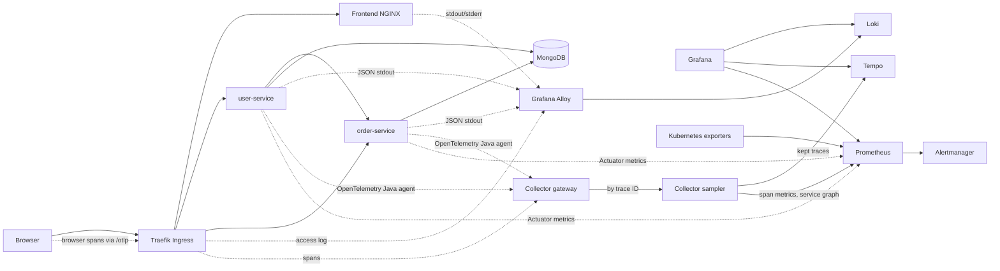

# DevOps Learning Roadmap — Local KinD Lab Execution Guide

> **Purpose**: A complete operational guide to practicing 75%+ of the `LEARNING-ROADMAP.md` locally using KinD (Kubernetes in Docker) for **$0**, with fast feedback loops, zero risk of AWS surprise billing, and rapid teardown/rebuild.

---

## 1. Executive Summary & Strategy

The learning roadmap spans 43 real-world engineering steps. Running all of them directly on AWS EKS incurs compute costs, ALB costs, NAT Gateway charges, and slow iteration times (15+ min provisioning/teardown).

By using a local **KinD (Kubernetes in Docker)** multi-node cluster (`dev-lab`), you can master:
- **Core Kubernetes Architecture**: RBAC, Probes, Resource limits, PDBs, StatefulSets, PVCs, Helm authoring.
- **Full Observability Stack**: Prometheus, Grafana, Alertmanager, Grafana Alloy, Loki, OpenTelemetry, Tempo.
- **Event Streaming**: Strimzi Kafka, Kafka Topics/Users, Schema Registry, Kafka Connect, KEDA.
- **Traffic & Mesh**: Kong Ingress, Gateway API, rate limiting, Linkerd/Istio mTLS, NetworkPolicies.
- **Progressive Delivery**: Argo Rollouts (Canaries, Blue/Green, automated analysis), Argo Workflows.
- **Security & Reliability**: Kyverno policies, Falco eBPF, Vault, Chaos Mesh, k6 load testing.

### The 3-Tier Execution Model

```
┌────────────────────────────────────────────────────────────────────────┐
│  Tier 1: 100% Local in KinD ($0, complete fidelity)                   │
│  Steps: 01, 02, 05, 06, 07, 08, 09, 10, 11, 12, 13, 15, 16, 17, 18,   │
│         19, 20, 21, 22, 24, 26, 27, 28, 29, 30, 32, 35, 39, 40, 41   │
├────────────────────────────────────────────────────────────────────────┤
│  Tier 2: KinD with Lightweight Local Mocks ($0)                        │
│  • Ingress/TLS: Ingress-NGINX or Kong + cert-manager local CA (Step 03)│
│  • Storage / S3: MinIO or LocalStack (Step 10, 21)                    │
│  • Databases: Bitnami Postgres / Redis in KinD (Step 23, 26)           │
├────────────────────────────────────────────────────────────────────────┤
│  Tier 3: AWS Cloud-Only (Timeboxed 1–2 hr sessions)                   │
│  • Step 03: AWS ALB Controller + ACM + Route53 public validation       │
│  • Step 04: Karpenter EC2 spot provisioning                            │
│  • Step 14: AWS MSK Serverless                                        │
│  • Step 23: AWS RDS Multi-AZ failover drill                            │
│  • Step 25: AWS Backup                                                 │
│  • Step 31: GuardDuty, Security Hub, AWS Config, CloudTrail           │
│  • Step 33: GitHub Actions OIDC to AWS IAM                             │
│  • Step 37 & 42: Multi-account Terragrunt & Multi-region DR            │
└────────────────────────────────────────────────────────────────────────┘
```

---

## 2. KinD Cluster Configuration & Adjustments

### 2.1 Current Cluster vs Ingress-Ready Cluster

Your current cluster was created with:
```yaml
kind: Cluster
apiVersion: kind.x-k8s.io/v1alpha4
nodes:
- role: control-plane
- role: worker
- role: worker
```

#### How to access services in the ingress-ready cluster:
The repository's `kind-config.yaml` already maps host ports 80 and 443 to the
control-plane node. After installing the local NGINX Ingress Controller and
syncing the local applications, the frontend is available without a frontend
port-forward:
```bash
# Frontend and API routes
open http://localhost
```

`scripts/start-lab.sh` installs Traefik v3 as the ingress controller (it
replaced ingress-nginx, which was retired upstream in March 2026), bound to
host ports 80/443 on the control-plane node, with JSON access logs and
OpenTelemetry tracing to the collector. To do it by hand once per KinD
cluster:
```bash
helm upgrade --install traefik traefik --repo https://traefik.github.io/charts \
  --version 41.6.1 -n traefik --create-namespace \
  -f local-setup/traefik-values.yaml --wait
```
The application Ingress is the same object the cloud ALB serves;
`apps/local` only sets `ingressClassName: traefik`.

ArgoCD is not part of the application Ingress, so keep a separate secure
port-forward for its UI:
```bash
# ArgoCD UI
kubectl port-forward svc/argocd-server 8443:443 -n argocd
open https://localhost:8443

# Grafana UI
kubectl port-forward svc/kube-prometheus-stack-grafana 3000:80 -n monitoring
```

Do not port-forward `svc/frontend` when using `http://localhost`; that bypasses
the Ingress and sends `/api/*` requests to the static NGINX frontend, producing
`405 Method Not Allowed` responses.

#### Upgrading to an Ingress-Ready Cluster (Optional, for Step 03 / Step 16):
If you want to access workloads directly via `http://localhost` and `http://localhost/api` without manual port forwards, use this configuration:
```yaml
# kind-config-ingress.yaml
kind: Cluster
apiVersion: kind.x-k8s.io/v1alpha4
nodes:
- role: control-plane
  kubeadmConfigPatches:
  - |
    kind: InitConfiguration
    nodeRegistration:
      kubeletExtraArgs:
        node-labels: "ingress-ready=true"
  extraPortMappings:
  - containerPort: 80
    hostPort: 80
    protocol: TCP
  - containerPort: 443
    hostPort: 443
    protocol: TCP
- role: worker
- role: worker
```

---

### 2.2 Storage in KinD (Ready for Step 05 & Stateful Workloads)

KinD comes pre-configured with Rancher's `local-path-provisioner`:
```bash
kubectl get storageclass
# NAME                 PROVISIONER             RECLAIMPOLICY   VOLUMEBINDINGMODE
# standard (default)   rancher.io/local-path   Delete          WaitForFirstConsumer
```

- Any PVC requesting `storageClassName: standard` (or leaving it default) will automatically dynamically provision volumes backed by the node's Docker filesystem.
- Perfect for:
  - Step 05: StatefulSet testing
  - Step 07: Prometheus TSDB persistence
  - Step 12: Strimzi Kafka brokers
  - Step 30: HashiCorp Vault Raft storage

---

### 2.3 Metrics Server in KinD (Required for HPA / Step 04)

KinD nodes use self-signed kubelet TLS certificates. Metrics Server needs `--kubelet-insecure-tls` to read CPU/memory:

```bash
helm repo add metrics-server https://kubernetes-sigs.github.io/metrics-server/
helm upgrade --install metrics-server metrics-server/metrics-server \
  --namespace kube-system \
  --set args="{--kubelet-insecure-tls}"

# Verify after 30 seconds:
kubectl top nodes
kubectl top pods -A
```

---

## 3. GitOps Repository Layout for Local vs. AWS

In `Gitops/bootstrap/envs/dev`, your setup includes cloud-dependent controllers:
- `aws-lb-controller-dev.yaml` (needs AWS IAM & VPC)
- `karpenter-dev.yaml` (needs AWS EC2 APIs & IAM roles)
- `external-secrets-operator-dev.yaml` (needs AWS Secrets Manager)

### Recommended: Add a Local Overlay

The repository already contains `bootstrap/envs/local/kustomization.yaml`. It
deploys `local-apps` plus the shared cluster add-ons in `addons/applications`
(kube-prometheus-stack, Loki, Alloy, Tempo, OTel Collector, metrics-server).
Every environment uses the same add-on Applications; only their Helm values
differ, layered from `addons/values`:

| File | Applies to |
|---|---|
| `addons/values/common/<addon>.yaml` | every environment |
| `addons/values/local/<addon>.yaml` | the KinD lab (small sizing, filesystem storage, `admin` Grafana password) |
| `addons/values/cloud/<addon>.yaml` | dev, staging and prod on EKS (S3, IRSA, gp3) |
| `addons/values/<env>/<addon>.yaml` | one environment, when it needs to differ |

`bootstrap/envs/<env>/kustomization.yaml` chooses the tier and environment for
its add-ons with the `addons/select-env` component.

This ensures your local KinD cluster runs the core applications and observability stack without crashing on AWS-specific IAM controllers.

There are two ways to deploy it:

| Flow | Command | Who deploys |
|---|---|---|
| Docker Desktop | `./scripts/start-lab.sh` | ArgoCD, from `root-app-local` (syncs the checked-out branch, which must be pushed; set `LAB_REVISION` to pick another) |
| Podman | `./scripts/start-lab-podman.sh` | `scripts/sync-local-stack.rb`, which runs `helm upgrade --install` with the chart versions from `addons/applications` and the values from `addons/values/{common,local}` and `kubectl apply -k apps/local` from your working tree. ArgoCD stays installed for its UI, with auto-sync off. |

order-service is deployed from this repo's own Helm chart (`charts/microservice`,
values in `apps/local/order-service.values.yaml`; see `docs/HELM.md`); the
other two services from `apps/local` with Kustomize. The sync handles both.

After a code change in `../app`, rebuild and restart one or more services with
`./scripts/update-and-redeploy-podman.sh order-service`.

The lab runs its own MongoDB (`apps/local/mongodb.yaml`): a one-replica
StatefulSet with a 2Gi volume, so the services work with no external
database and no setup. The services read their connection string from the
`app-secrets` Secret, which `start-lab.sh` creates from
`apps/local/app-secrets.env` if you have that git-ignored file (for example
with a MongoDB Atlas URI), and otherwise from the committed
`app-secrets.env.example`, which points at the lab MongoDB. ArgoCD doesn't
manage this Secret. To change it by hand:

```bash
cp apps/local/app-secrets.env.example apps/local/app-secrets.env
# Edit apps/local/app-secrets.env, e.g. set MONGO_URI to your Atlas URI.
kubectl create secret generic app-secrets \
  --namespace development \
  --from-env-file=apps/local/app-secrets.env \
  --dry-run=client -o yaml | kubectl apply -f -
kubectl rollout restart deploy/order-service deploy/user-service -n development
```

Look inside the lab database with
`kubectl exec -it mongodb-0 -n development -- mongosh microservices`.

---

## 4. Phase-by-Phase Roadmap Execution in KinD

### 4.0 Local Observability Flow



What each component does:

| Component | Responsibility |
|---|---|
| Traefik | Routes `/` to frontend, `/api` to the backend services and `/otlp` to the collector; traces every request and writes JSON access logs. |
| Grafana Alloy | One replica reads every pod's stdout through the Kubernetes API, masks tokens and passwords, labels each line `log_type=edge` (Traefik's access log), `api` (one per request in a service) or `server`, and sends them to Loki as tenant `apps` (application namespaces) or `platform`. |
| Loki | Stores and searches logs, per tenant; use LogQL in Grafana. |
| OpenTelemetry web SDK | Records the browser's fetch spans and sends them to `/otlp/v1/traces`; adds `traceparent` to API calls. |
| OpenTelemetry Java agent | Creates HTTP, MongoDB, and downstream-client spans without custom filters, and sends every span. |
| Collector gateway | Receives all spans (apps, Traefik, browser), adds pod/deployment/namespace, forwards each trace to one sampler by trace ID. |
| Collector sampler | Computes span metrics and the service graph from every span, then keeps every error trace, every trace over 500ms and a share of the rest (100% in the lab) for Tempo. |
| Tempo | Stores and searches distributed traces. |
| Prometheus | Scrapes Kubernetes, Spring Boot and span metrics; evaluates the SLO, service and pipeline rules. |
| Alertmanager | Routes alerts (in the lab: shown in its UI and Grafana only). |
| Grafana | Queries Prometheus, Loki, and Tempo in one UI, with links between logs, traces and metrics. |

Typical request flow:

```text
Browser -> Traefik -> user-service -> order-service -> MongoDB
   |          |            |                |
   |          |            |                +-- span -> gateway -> sampler -> Tempo
   |          |            +------------------- span -> gateway -> sampler -> Tempo
   |          +-- span -> gateway; access log -> Alloy -> Loki
   +-- span via /otlp -> gateway
```

All of a request's spans share one trace ID from the browser onward, so Tempo
shows the whole request: the browser's fetch, Traefik, user-service, the
call to order-service and MongoDB. The browser console logs the same trace ID.

[`docs/observability-pipeline.html`](docs/observability-pipeline.html) maps every
hop to the file that configures it.

### 4.1 Edge, API and server logs in Grafana

One request produces up to three kinds of log line. Alloy labels each with
`log_type`, so picking one is a label filter, not a setting:

| `log_type` | Written by | When | Tells you |
|---|---|---|---|
| `edge` | Traefik, the ingress (its access log) | once per request, at the entrance | what the client saw: status, total time, client address |
| `api` | each service's `RequestLoggingFilter` (logger `access.<service>.http`) | once per request, inside the service | method, route, status, duration and, where enabled, the request payload |
| `server` | everything else a service (or Traefik) writes | any time | business events (`auth_signin_succeeded`), warnings, errors with stack traces |

All three carry the request's `trace_id`, so from any line you can open the
trace or find the other two. Health checks (`/actuator/...`) aren't logged as
API calls: they are Kubernetes and Prometheus traffic, not users.

API log fields use the OpenTelemetry names, the same as on the trace spans:

| Field | Example |
|---|---|
| `http.request.method` | `POST` |
| `url.path` | `/api/orders/user/alice` (the query string is left out: it can hold secrets) |
| `http.route` | `/api/orders/user/{userId}`, the same for every user, so group by this |
| `http.response.status_code` | `201` |
| `duration_ms` | `12` |
| `http.request.body.size` | `58` |
| `http.request.body.content` | `{"username":"alice","password":"<redacted>"}`, only where enabled (below) |
| `error.type` | `java.lang.IllegalStateException`, only when an exception escaped |

**Request payloads** are set per environment in `apps/<env>/kustomization.yaml`
(ConfigMap `request-logging`; see `apps/components/request-logging`):

| Environment | `APP_HTTP_LOGGING_REQUEST_BODY` | Payload logged for |
|---|---|---|
| local, dev | `ALWAYS` | every request |
| staging, prod | `ERRORS` | failed requests (4xx/5xx) only |
| not set | `NEVER` | none |

Only JSON payloads are logged. Any key containing password, token, secret
(and similar) is masked by the service, and again by Alloy, and the payload
is cut at 2048 characters. Response bodies are never logged: they carry the
most personal data and are rarely needed, because the status code and the
trace show what happened.

Where to look:

- **Dashboard:** *Microservices* → **API calls**: one readable line per
  request, e.g. `user-service  POST /api/auth/signin → 200 in 87ms  payload={...}  trace_id=...`.
  **Edge requests** shows the same requests as Traefik saw them, and
  **Application Logs** with **Log type** = `server` shows the rest.
- **Explore** (Loki datasource):

  ```logql
  # Failed API calls, with their payload
  {namespace="development", log_type="api"} | json | http_response_status_code >= 400
  # Slow calls
  {namespace="development", log_type="api"} | json | duration_ms > 500
  # What clients saw at the entrance
  {namespace="traefik", log_type="edge"} | json | KubernetesIngressNamespace="development"
  ```

  `| json` turns the fields into filters, with dots replaced by underscores
  (`http.response.status_code` becomes `http_response_status_code`).

Click the **trace_id** link on a log line to open its trace in Tempo, or
**Logs for this span** on a span to go the other way.

### 4.2 Alerts, SLOs and dashboards

`observability/base` holds what is deployed to every environment:

- **Dashboards** (Grafana → Dashboards): *Microservices* (pods, API rates,
  latency, logs with a Log type dropdown, failed requests whose dots open the
  trace) and *Service Level Objectives* (30-day attainment, error budget
  left, burn rates).
- **SLOs:** 99.5% of requests without a 5xx and 99% within 500ms, per
  service. Alerts use multi-window burn rates: they page when the error
  budget is burning fast and clear soon after a fix.
- **Service alerts:** `ServiceUnavailable` (no ready pods at all) and
  `ServiceDown` (a pod not answering scrapes) page; the services' SLO alerts
  are held back while either fires.
- **Pipeline alerts** if logs or traces stop reaching Loki or Tempo.

In the lab, alerts are only shown in Grafana (Alerting) and Alertmanager
(`kubectl port-forward svc/kube-prometheus-stack-alertmanager 9093 -n monitoring`).
Each alert links to its runbook in [`docs/runbooks.md`](docs/runbooks.md). The rules
are unit-tested (`tests/prometheus`) by `./scripts/validate.sh`.

To prove the whole path works, run an alert drill: it scales one service to
0, waits for `ServiceUnavailable` in Alertmanager, restores it and waits for
the alert to clear (about 4 minutes; works the same on EKS):

```bash
./scripts/alert-drill.sh order-service development
```

### Phase A: Core Kubernetes (Steps 01 – 06)

| Step | Topic | Local KinD Execution |
|---|---|---|
| **01** | `01-k8s-rbac` | Create `ServiceAccount`, `Role`, `RoleBinding`, `ClusterRole`. Test permissions with `kubectl auth can-i --as=system:serviceaccount:development:frontend`. Test `ResourceQuota` and `LimitRange`. |
| **02** | `02-production-workloads` | Add `readinessProbe`, `livenessProbe`, `startupProbe`, `PodDisruptionBudget`, `topologySpreadConstraints` (across nodes), and `securityContext` (`runAsNonRoot`). Drain a worker node (`kubectl drain dev-lab-worker --ignore-daemonsets`) and watch traffic survive. |
| **03** | `03-ingress-tls-dns` | **Local**: Install `ingress-nginx` or Kong. Issue self-signed certs with `cert-manager`.<br>**Cloud**: Later run external-dns + Route53 + ACM on AWS EKS. |
| **04** | `04-autoscaling` | **Local**: Metrics Server + HPA on CPU/memory. Generate load with busybox `wget` loop; watch pods scale from 2 to 10.<br>**Cloud**: Karpenter EC2 spot provisioning. |
| **05** | `05-storage-statefulsets` | Deploy a StatefulSet (e.g., PostgreSQL or Redis) with `volumeClaimTemplates` using `storageClassName: standard`. Kill a pod, confirm data persistence and stable hostname (`pod-0`). |
| **06** | `06-helm-authoring` | Write `charts/microservice/`. Test locally with `helm lint`, `helm template`, and `helm unittest`. Deploy into KinD using `helm upgrade --install`. |

---

### Phase B: Observability (Steps 07 – 11)

| Step | Topic | Local KinD Execution |
|---|---|---|
| **07** | `07-prometheus-grafana` | Deploy `kube-prometheus-stack`. Set up `ServiceMonitor` for `frontend`, `order-service`, and `user-service`. Port-forward Grafana (`3000:80`). Build dashboards with PromQL. |
| **08** | `08-alerting-slo` | Write `PrometheusRule` CRDs (high error rate, burn rate). Configure Alertmanager with Slack/Discord webhook. Deliberately break a pod and verify the alert fires. |
| **09** | `09-elk-logging` / Loki | Deploy Grafana Alloy + Loki (or ECK / Fluent Bit). Ship JSON logs with correlation IDs. Query logs in Grafana. |
| **10** | `10-tracing-otel` | Instrument apps with OpenTelemetry SDK. Deploy OTel Collector and Grafana Tempo in KinD. Trace request path: `frontend` → `order-service` → `user-service`. |
| **11** | `11-synthetic-blackbox` | Deploy Prometheus `blackbox_exporter`. Probe internal/external endpoints for HTTP 200, TLS expiry, and latency. |

---

### Phase C: Event Streaming & Autoscaling (Steps 12 – 15)

| Step | Topic | Local KinD Execution |
|---|---|---|
| **12** | `12-kafka-strimzi` | Install Strimzi operator via Helm. Deploy a 3-broker KRaft Kafka cluster on KinD workers with PVCs. Create `KafkaTopic` and `KafkaUser`. Produce/consume messages. Kill a broker to test ISR resilience. |
| **13** | `13-kafka-ecosystem` | Deploy Apicurio / Confluent Schema Registry. Deploy Kafka Connect. Run an Outbox pattern simulation. |
| **14** | `14-msk-managed` | *AWS only (timebox 1 hr with MSK Serverless).* |
| **15** | `15-keda-autoscaling` | Install KEDA in KinD. Add `ScaledObject` targeting Kafka consumer lag. Produce 5,000 messages; watch consumers scale from 0 → 8 → 0. |

---

### Phase D: API Gateway & Service Mesh (Steps 16 – 19)

| Step | Topic | Local KinD Execution |
|---|---|---|
| **16** | `16-kong-gateway` | Deploy Kong Ingress Controller in DB-less mode in KinD. Route `/api/orders` and `/api/users`. Compare with K8s Gateway API (`HTTPRoute`). |
| **17** | `17-kong-plugins` | Enable plugins: rate limiting (backed by Redis container), key-auth, JWT validation, CORS, request transformation. |
| **18** | `18-service-mesh` | Install Linkerd or Istio in KinD. Mesh namespaces. Verify mTLS between services using `linkerd viz` or `istioctl`. Test 90/10 traffic splitting. |
| **19** | `19-network-policies` | Install Calico or Cilium in KinD. Create default-deny NetworkPolicies. Allow only legitimate microservice-to-microservice traffic. |

---

### Phase E: Progressive Delivery (Steps 20 – 22)

| Step | Topic | Local KinD Execution |
|---|---|---|
| **20** | `20-argo-rollouts` | Install Argo Rollouts controller + kubectl plugin. Replace `Deployment` with `Rollout`. Configure canary release (10% → 25% → 50% → 100%) with `AnalysisTemplate` querying Prometheus. Simulate bad deployment; watch auto-rollback. |
| **21** | `21-argo-workflows-events` | Deploy Argo Workflows. Build a DAG pipeline (build → test → scan). Set up MinIO in KinD for artifact storage. |
| **22** | `22-feature-flags` | Deploy Unleash in KinD. Toggle features dynamically in `frontend` without redeployment. |

---

### Phase F & G: Data & Security (Steps 24 – 32)

| Step | Topic | Local KinD Execution |
|---|---|---|
| **24** | `24-db-migrations` | Run Flyway as an ArgoCD PreSync hook Job against a PostgreSQL container in KinD. Practice expand-contract schema changes. |
| **26** | `26-dynamodb-caching` | Run Redis in KinD. Test cache-aside, cache invalidation, and thundering herd mitigations. |
| **27** | `27-pod-security-policy` | Enforce Pod Security Standards (`restricted`). Install Kyverno; write policies blocking `:latest` tags, requiring non-root, and auto-injecting NetworkPolicies. |
| **28** | `28-supply-chain` | Run Trivy vulnerability scans in CI. Sign images with Cosign. Enforce signature verification at admission via Kyverno. |
| **29** | `29-runtime-security` | Install Falco with eBPF in KinD. Exec into a pod or touch `/etc/shadow`; verify alert triggers. |
| **30** | `30-vault` | Deploy HashiCorp Vault in HA mode (3 replicas with Raft storage). Configure Kubernetes authentication and dynamic secrets. |
| **32** | `32-compliance-benchmarks` | Run `kube-bench` and `kube-hunter` against KinD to audit cluster configuration. |

---

### Phase H & I: Resilience, Testing & Cost (Steps 35 – 41)

| Step | Topic | Local KinD Execution |
|---|---|---|
| **35** | `35-sonarqube-gates` | Run SonarQube in KinD. Gate code PRs on 80% coverage and zero vulnerabilities. |
| **39** | `39-chaos-engineering` | Install Chaos Mesh in KinD. Run experiments: pod kills, network latency injection, packet loss. Observe SLO impact in Grafana. |
| **40** | `40-load-testing` | Run k6 as a K8s Job. Execute ramp-up, spike, and soak tests. Measure bottleneck thresholds. |
| **41** | `41-cost-optimization` | Install OpenCost / Kubecost in KinD. Understand CPU/memory cost attribution per namespace. |

---

## 5. Daily Local Workflow Checklist

When starting a study session:

```bash
# 1. Verify cluster is running
kubectl get nodes

# 2. Check cluster resource consumption on Docker
docker stats --no-stream

# 3. Create or switch to the lesson branch
git checkout -b <lesson-name>

# 4. Implement manifests, apply to KinD, and verify
kubectl apply -k <path-to-overlay>

# 5. Break it intentionally to verify resilience & alerting
kubectl delete pod -l app=order-service
kubectl drain dev-lab-worker --ignore-daemonsets

# 6. Document your findings
echo "### $(date) - Notes on <lesson-name>" >> NOTES.md

# 7. Commit & push branch
git commit -am "Complete <lesson-name>"
```

### When to turn off the cluster:
You don't even need to delete the cluster between sessions! You can simply pause the node containers:
```bash
# Pause cluster (saves CPU and battery on Mac):
./scripts/stop-lab.sh            # Docker
./scripts/pause-lab-podman.sh    # Podman

# Resume cluster:
./scripts/start-lab.sh           # Docker
./scripts/start-lab-podman.sh    # Podman
```

To permanently delete the local cluster and all Kubernetes data, including
Pods, Secrets, PVCs, and monitoring history, run:
```bash
./scripts/clean-lab.sh
```
Confirm by typing `DELETE`. Use `./scripts/clean-lab.sh --yes` for automation.
This does not delete repository files or the ignored `apps/local/app-secrets.env`.
After cleanup, `./scripts/start-lab.sh` recreates the cluster, loads any locally
built application images, restores `apps/local/app-secrets.env` when present,
installs ArgoCD and the local NGINX Ingress Controller, and applies the local
root Application automatically. If an image is missing, build it first with
`./scripts/build-and-push.sh`.

Or destroy and recreate in 30 seconds:
```bash
kind delete cluster --name dev-lab
kind create cluster --name dev-lab --config kind-config.yaml
```

---

## 6. Access, Queries & Troubleshooting

### Access

```bash
# Frontend plus API through the local NGINX Ingress.
# Don't port-forward svc/frontend: that bypasses /api routing (405 on POST).
open http://localhost

# ArgoCD UI
kubectl port-forward svc/argocd-server 8443:443 -n argocd
open https://localhost:8443

# Grafana UI
kubectl port-forward svc/kube-prometheus-stack-grafana 3000:80 -n monitoring
open http://localhost:3000

# Prometheus UI and scrape targets (use 9091:9090 if 9090 is busy)
kubectl port-forward svc/kube-prometheus-stack-prometheus 9090:9090 -n monitoring
open http://localhost:9090/targets
```

### Starter PromQL (Grafana → Explore → Prometheus)

```promql
# Is every scrape target up?
up

# Ready application Pods
kube_pod_status_ready{namespace="development",pod=~"(frontend|user-service|order-service)-.*"}

# CPU and memory of the three application Pods
rate(container_cpu_usage_seconds_total{namespace="development",pod=~"(frontend|user-service|order-service)-.*",container!="POD",container!=""}[5m])
container_memory_working_set_bytes{namespace="development",pod=~"(frontend|user-service|order-service)-.*",container!="POD",container!=""}

# HTTP request rate from the Spring Boot services
sum by (job, uri, method, status) (rate(http_server_requests_seconds_count{namespace="development"}[5m]))
```

### Problems already hit, and their fixes

| Symptom | Cause | Fix |
|---|---|---|
| Services exit with code 1 during Spring startup | MongoDB URI typed as `mmongodb+srv://` | Correct `MONGO_URI` in `apps/local/app-secrets.env` and recreate the Secret |
| ArgoCD can't create `app-secrets` | The env file is git-ignored, so ArgoCD can't read it | `start-lab.sh` creates the Secret directly (section 3) |
| ArgoCD kustomize rejects bootstrap files | Files outside the Application's source directory | Local Application manifests live under `bootstrap/envs/local/` |
| `405` on `POST /api/auth/signup` | `svc/frontend` port-forward sent API calls to the static nginx | Use `http://localhost` through the Ingress |
| `403` from the browser | `http://localhost:8000` missing from backend CORS origins | Added to user-service's CORS config and rebuilt the image |
| Grafana shows no data, Prometheus has no endpoint | Prometheus Operator hadn't reconciled the Prometheus resource | Restart the operator Deployment |
| Explore: `unsupported protocol scheme ""` | An old lowercase `loki` datasource with an empty URL | Use the datasource named `Loki`; delete the other |

### Troubleshooting commands

```bash
kubectl get pods -n development
kubectl get pods -n monitoring
kubectl get servicemonitor -A
kubectl get endpoints kube-prometheus-stack-prometheus -n monitoring
```

Healthy state: the Prometheus Pod is Running, its Service has an endpoint, both
`order-service-monitor` and `user-service-monitor` show as UP on
`/targets`, and `kube-prometheus-stack` is Synced and Healthy in ArgoCD.
